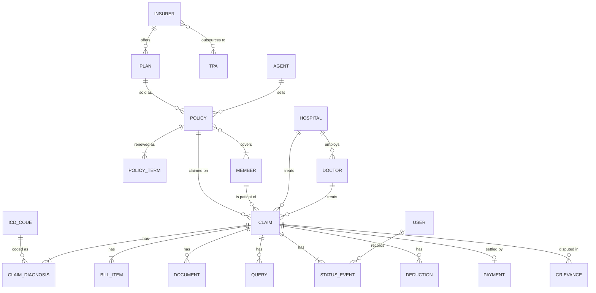

# ClaimSure: Database Design Report

This report explains the database decisions behind ClaimSure: the data model, how it compares with a relational design, consistency and concurrency, indexing, scaling, recovery and security. Each section names the code or page where the feature can be seen running.

---

## 1. Conceptual model (ER)

There are 21 entity types. In MongoDB they become **14 collections**: the seven claim-owned entities are embedded in the claim, and policy terms and covered members are embedded in the policy.

## 2. The relational alternative (3NF)

A normalised relational schema for the same model needs about 22 tables:

| Area | Tables |
|---|---|
| Reference | insurers, tpas, insurer_tpas, plans, plan_sub_limits, plan_exclusions, icd_codes, agents, users |
| People | members, member_conditions |
| Policies | policies, policy_members, policy_terms |
| Providers | hospitals, hospital_insurers, doctors |
| Claims | claims, claim_diagnoses, claim_bill_items, claim_documents, claim_queries, claim_status_events, claim_deductions, claim_fraud_flags |
| Money and service | payments, grievances, audit_logs |

**What the claim detail page costs in each design:**

| | Relational (3NF) | ClaimSure (documents) |
|---|---|---|
| Load one claim with bill, diagnoses, documents, queries, history, deductions, fraud flags | 1 query with 7 joins, or 8 queries | **1 document read** |
| Plus patient, policy, plan, hospital, doctor | 5 more joins | 5 point reads by unique index |
| Change status and record history | UPDATE + INSERT, in a transaction | **1 atomic update** (`$set` + `$push`) |
| Settle a claim | Transaction over 4 tables | Transaction over 4 collections (same guarantee) |

### Where ClaimSure denormalises, and why it is safe

| Copy | Why | Update anomaly? |
|---|---|---|
| `claims.snapshot` (patient name, age, hospital name, city, tier) | Claim lists render without joins | No. It is a **historical record** of the facts at admission, so it must *not* change when the master changes. |
| `policies.insured_members[]` (name, relation, DOB, declared conditions) | Adjudication reads one document | Rare: changes go through the policy endorsement process, which updates both. |
| `claims.insurer_id`, `plan_id`, `tpa_id` | Analytics group without joining policies | No: a claim's insurer never changes after intimation. |
| Computed fields (`tat_days`, `available_cover`, fraud score) | Dashboards don't recompute on every read | Kept correct by the service layer, which is the only writer. |

## 3. Consistency, isolation and concurrency

| Mechanism | Where | Demonstrated in |
|---|---|---|
| Single-document atomicity | Status change plus history entry in one `update_one` | Every workflow action |
| Optimistic locking (`version` field) | Claim forms post the version the user saw; a stale update matches 0 documents and is refused | Claim page; Concurrency Lab C |
| Atomic guarded update | Policy cover: `$inc` with `available_cover: {$gte: amount}` | Concurrency Lab B |
| Multi-document ACID transaction | Settlement over claims, policies, payments, audit_logs | Claim page "Pay" / "Simulate failure"; Concurrency Lab D |
| Snapshot isolation and write conflicts | Two concurrent transactions on one policy: the second gets `WriteConflict`, `with_transaction()` retries it | Concurrency Lab D; `tests_live/test_live_features.py` |
| Unique index as a constraint | `payments.claim_number`: a claim can never be paid twice | `scripts/03_indexes.js`; live tests |

**Read and write concerns.** Transactions use `readConcern: "snapshot"` and `writeConcern: "majority"`. A committed payment is on a majority of replica-set members, so it survives the primary failing, and the transaction sees one consistent snapshot of all four collections.

**CAP.** A replica set with majority writes favours **consistency** during a network partition. A minority side cannot accept writes, and an election (about 10 seconds) picks a new primary. Reads go to the primary, so users always read their own writes. For an insurer, refusing a write briefly is better than paying a claim twice.

## 4. Indexing

There are 50 secondary indexes in `schema/indexes.json`, of nine types: unique, compound (ESR rule), single field, multikey, text, partial, sparse, TTL and 2dsphere. Each index has a written purpose (DB Console, Indexes).

Measured on 100,000 documents with `explain("executionStats")` (Scale Benchmark page):

| Query | Without index | With index | Lesson |
|---|---|---|---|
| One member's claims, newest first | COLLSCAN + SORT, 100,000 docs | IXSCAN, 20 docs, **~40x faster** | Compound index serves filter and sort |
| Covered query (indexed fields only) | 100,000 docs | **0 docs** (PROJECTION_COVERED) | The index alone answers the query |
| Claims above Rs 10 lakh | 100,000 docs | 12 docs, **~100x faster** | Selective range |
| Claims since a date | COLLSCAN | **still COLLSCAN** | Prefix rule: `submitted_at` is not the leading field |
| Unanchored regex on state | 100,000 docs | reads all 100,000 keys, slower | Regex without `^` cannot seek |
| Status = Settled (78% of rows) | 100,000 docs | 78,107 docs, slower | Low selectivity: indexes help selective queries only |

## 5. Scaling: sharding design

Atlas M0 cannot shard, so this is a design. It is the plan for when the claim volume outgrows one replica set.

| Collection | Shard key | Reasoning |
|---|---|---|
| `claims` | `{ member_id: "hashed" }` | Even spread of writes (no hot shard from ever-increasing claim numbers). Member history, duplicate-stay checks and the claim page target one shard. Insurer dashboards scatter-gather, which is acceptable for analytics and better served by the materialised view anyway. |
| `policies` | `{ policy_number: "hashed" }` | Point lookups by policy number; claims carry the policy number. |
| `payments` | `{ claim_number: "hashed" }` | Keeps the unique constraint on `claim_number` possible (a unique index must include the shard key). |
| `audit_logs` | `{ entity_id: "hashed" }` | Spreads append-heavy writes; "history of one record" stays on one shard. |
| Masters (insurers, plans, hospitals, icd_codes, users) | not sharded | Small and read-mostly; they live on the primary shard and are cheap to `$lookup`. |

**Rejected keys:**
- `claim_number` (ranged) is monotonic, so every insert would hit the last chunk.
- `status` has low cardinality and changes over the claim's life.
- `admission_date` puts all current writes in one range.

Multi-document transactions work across shards (MongoDB 4.2+), so settlement still works.

## 6. Backup and recovery

| Layer | ClaimSure | Production equivalent |
|---|---|---|
| Logical backup | `python main.py backup` writes every collection as Extended JSON plus a manifest; Maintenance page | `mongodump` / `mongorestore` (BSON) |
| Restore | `python main.py restore NAME` drops, re-applies validators, reloads, rebuilds indexes | `mongorestore --drop` |
| Point-in-time | n/a on M0 | Atlas continuous backup replays the **oplog** to any second |
| Crash safety | n/a | WiredTiger **journal**: committed writes survive a process crash |
| Retention | `audit_logs` TTL index removes entries after 3 years | Same |

Target for the claims system: **RPO** of a few seconds (oplog-based backup) and **RTO** under an hour (restore a snapshot, then replay the oplog).

## 7. Security model

| Control | Implementation |
|---|---|
| Authentication | Separate database users for the app, analysts, auditors and the DBA (`scripts/09_security.js`; Atlas Database Access) |
| Least privilege | The analyst account has `read` only: inserts, updates, deletes and drops are refused by the server (code 8000 on Atlas, code 13 on a self-hosted server), demonstrated on the Security page |
| Custom role | `claimsure_auditor_role`: `find` on `audit_logs` only |
| Data masking | `members_masked` view: no KYC numbers, initial-only names, last four phone digits |
| Encryption | Atlas uses TLS for every connection and encrypts storage at rest |
| Network | Atlas IP access list |
| Secrets | Connection strings in `.env` (git-ignored), never in source code |
| Accountability | Every change is written to `audit_logs`; change streams give a live feed |
| Application sign-in | Staff sign in to the web app; every page except the sign-in page needs a session |
| Password storage | `credentials` collection, 1 : 1 with `users` (unique index on `user_id`), kept separate so a reset of `users` never touches it. Passwords are stored as salted **scrypt** hashes (memory-hard), never in plain text |
| Sessions | `sessions` collection: the browser cookie (HttpOnly, SameSite=Lax, Secure over HTTPS) holds a random token, and only its SHA-256 digest is stored. A **TTL index** on `expires_at` deletes expired sessions. One aggregation (`$match` + two `$lookup`s) resolves the user on each request |
| Brute-force protection | Five wrong passwords lock the account for 15 minutes, using an atomic `$inc` on `failed_attempts`. Each IP address is also throttled |
| Access levels | Head Admin, Supervisor and Staff, from one permission matrix (`claimsure/auth.py`) that the routes, the services and the templates all read. Only the Head Admin can reopen closed cases, manage staff or reset the database |

### Application access levels

| Permission | Head Admin | Supervisor (Claims Manager) | Staff |
|---|:-:|:-:|:-:|
| Work claims within the role's approval limit | ✓ | ✓ | ✓ |
| Release payments (settlement transaction) | ✓ | ✓ | Senior Adjuster only |
| Re-open a rejected claim after an appeal | ✓ | ✓ | |
| Review fraud, re-run fraud rules, read the audit log | ✓ | ✓ | Fraud Analyst only |
| Conclude any re-verification | ✓ | ✓ | the assigned verifier |
| **Reopen a closed case for re-verification** | ✓ | | |
| Create or deactivate staff, change roles, reset passwords | ✓ | | |
| Reset or restore the database, run maintenance jobs | ✓ | | |

**Reopening a closed case.**
- Settled, Rejected and Withdrawn are terminal states. Only the Head Admin can move a claim out of them, into **Re-verification**, and must give a reason and pick a verifier.
- Each round is an entry in the embedded `reverifications` array: who reopened it, why, from which status, who verified it, the outcome and the findings.
- The outcome depends on whether money has left:
  - an unpaid claim (Rejected or Withdrawn) can be adjudicated again; the old decision is moved to `previous_adjudications`
  - a settled claim can only be upheld or flagged for recovery, so it is never paid twice (the unique index on `payments.claim_number` would refuse a second payment anyway)
- The reopen is guarded by the optimistic lock, and the server-side `$jsonSchema` enum was extended with the new status. On start-up the app compares each validator with `schema/validators.json` and runs `collMod` where they differ.

## 8. Schema evolution and data lifecycle

- **Schema versioning pattern.** Claims carry `schema_version`. Version 2 adds the optimistic-locking `version` field. The code reads both versions, and `python main.py migrate` (or the Maintenance page) upgrades documents in place with an idempotent `update_many`. This is how a flexible-schema database still manages change.
- **Validation** (`$jsonSchema`) keeps the flexible schema honest: 14 validators, enforced by the server.
- **Batch jobs.** Policy auto-renewal runs as one `bulk_write`, guarded by the old end date so it is idempotent.
- **Derived data.** `mv_insurer_monthly` is a materialised view refreshed with `$merge`. Two read-only views (`members_masked`, `open_claims_queue`) are computed on read.
- **Live data.** Change streams on claims, payments, policies and grievances feed the Live Feed page and `python main.py watch`.
